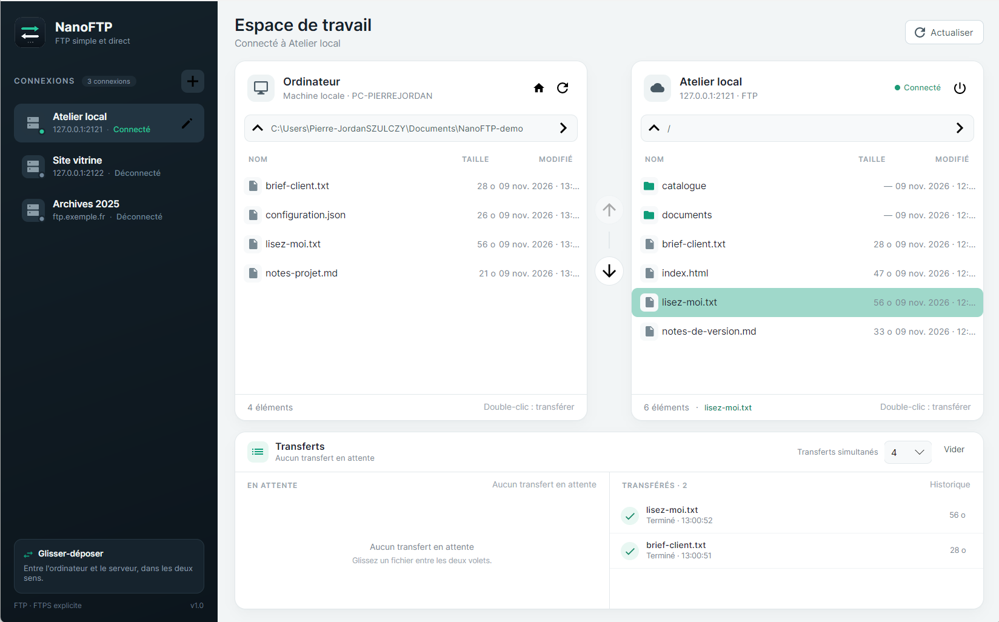
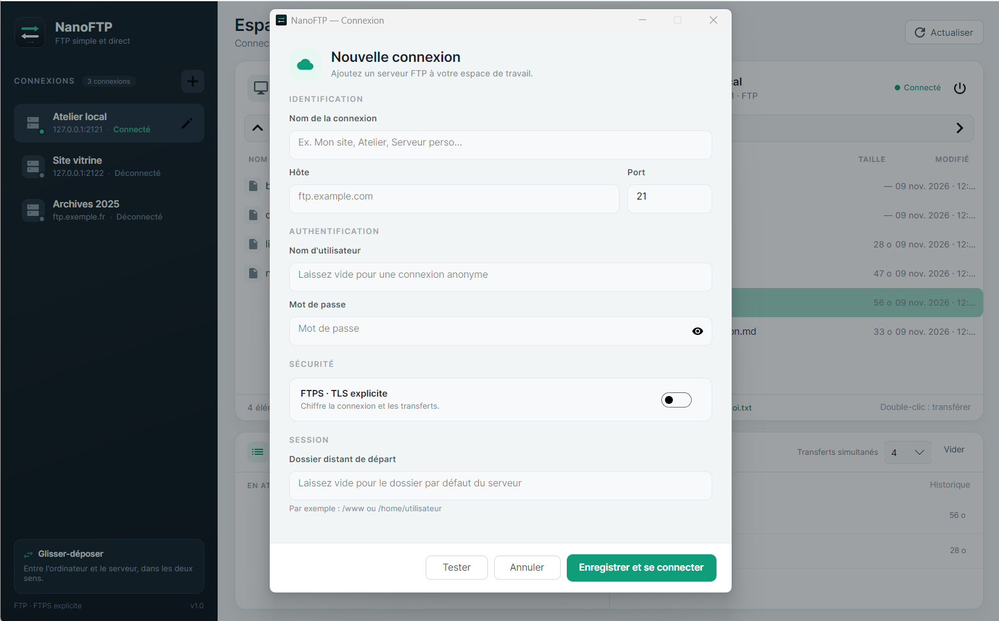

# NanoFTP

Un client FTP de bureau simple et direct, pour **Windows**, **Ubuntu/Linux** et **macOS**.
NanoFTP reprend l'essentiel de FileZilla : une barre latérale de connexions, deux
explorateurs côte à côte, le glisser-déposer dans les deux sens et une file de transferts
avec parallélisme réglable.

Tout tient dans une seule fenêtre, sans barre de menus. La seule fenêtre modale sert à
ajouter ou modifier une connexion.





## Mode Debug uniquement

NanoFTP est actuellement un projet en développement. **Seul le mode Debug est autorisé.**
Il n'y a ni paquet de distribution, ni certificat, ni signature, ni artefact binaire
versionné. Un binaire compilé en Release affiche un message et refuse de démarrer.

### Windows — le plus simple

Double-cliquez sur [`NanoFTP-debug.bat`](NanoFTP-debug.bat). Une fenêtre de terminal
s'ouvre, compile la version Debug puis lance NanoFTP. Elle reste ouverte après la fermeture
de l'application.

### macOS — le plus simple

Dans le Finder, double-cliquez sur [`NanoFTP-debug.command`](NanoFTP-debug.command).
Le Terminal s'ouvre et lance NanoFTP. Si nécessaire, rendez-le exécutable une fois :

```bash
chmod +x NanoFTP-debug.command
```

### Linux — le plus simple

Lancez le script depuis un terminal (les gestionnaires de fichiers Linux n'ouvrent pas
tous un terminal de la même façon) :

```bash
chmod +x NanoFTP-debug.sh
./NanoFTP-debug.sh
```

### Ligne de commande universelle

Prérequis : [.NET SDK 10](https://dotnet.microsoft.com/download) ou plus récent.

```bash
dotnet run -c Debug --project src/NanoFTP/NanoFTP.csproj
```

Le projet désactive l'apphost Windows (`UseAppHost=false`). NanoFTP est ainsi exécuté
par l'hôte `dotnet`, et non par un `NanoFTP.exe` généré dans le dossier de travail. C'est
important si ce dossier porte une étiquette d'intégrité Windows basse : l'apphost serait
lancé avec des droits d'écriture réduits, notamment vers le Bureau.

## Fonctionnalités

- Connexion **FTP** et **FTPS explicite** (TLS), mode passif.
- Barre latérale avec état de connexion en temps réel : déconnecté, connexion, connecté, erreur.
- Ajout, modification et suppression de connexions depuis une modale unique.
- Test de connexion directement dans la modale, avec erreurs lisibles.
- Deux volets **Ordinateur** / **Serveur** avec navigation par chemin, dossier parent,
  actualisation et double-clic.
- Sélection multiple (`Ctrl`/`Shift`) : le glisser-déposer transfère tous les fichiers et dossiers sélectionnés.
- Transferts par glisser-déposer dans les deux sens, par boutons centraux ou par double-clic.
- Téléchargement et envoi récursifs de dossiers.
- Clic droit sur un élément local : sélectionner, renommer en ligne, supprimer
  (après confirmation) ou ouvrir dans l'explorateur de fichiers.
- Dépôt de fichiers et de dossiers depuis l'explorateur du système vers le serveur.
- Si le dossier local cible est protégé en écriture, le téléchargement est redirigé vers
  `NanoFTP-downloads` à la racine du projet, avec un bandeau explicatif.
- File de transferts en bas de l'écran : **En attente** et **Transférés**, progression,
  annulation, relance des échecs et historique.
- Nombre de transferts simultanés réglable de 1 à 8, mémorisé entre les lancements.
- Rafraîchissement automatique du volet concerné après un transfert.
- Connexions et préférences conservées localement ; mots de passe chiffrés au repos.
- Raccourcis : `F5` pour actualiser, `Ctrl+N` pour ajouter une connexion.

## Ce que NanoFTP ne fait pas

Pour rester volontairement simple, cette version ne gère pas :

- SFTP / SSH (uniquement FTP et FTPS explicite) ;
- la reprise de téléchargement, la synchronisation ou les règles de filtrage ;
- la gestion d'un conflit de nom : un fichier existant est **remplacé**.

## Où sont stockées les données

En mode Debug, NanoFTP range ses données dans le dossier **`.nanoftp-data`** à la racine
du projet. Ce dossier est ignoré par Git et ne dépend d'aucun droit d'écriture système.

On y trouve :

- `connections.json` : connexions (sans mot de passe en clair) ;
- `secrets.key` : clé AES-GCM locale servant à chiffrer les mots de passe ;
- `settings.json` : nombre de transferts simultanés et dernière connexion choisie ;
- éventuellement `crash.log`.

Au premier lancement, si `.nanoftp-data` est vide, les données d'un ancien emplacement
sont importées automatiquement depuis la source la plus récente (`%LOCALAPPDATA%\NanoFTP`,
`NanoFTP-data` à côté des anciens binaires, ou `FoireZilla`). Aucun bandeau d'avertissement
n'est affiché : le dossier projet est toujours utilisé.

La variable d'environnement `NANOFTP_DATA_DIR` permet de choisir explicitement un autre
dossier.

### À propos des mots de passe

Les mots de passe sont chiffrés en AES-GCM avec une clé aléatoire créée localement.
Cela évite de les retrouver en clair dans un fichier de configuration, mais ne protège
pas contre un attaquant qui aurait déjà accès à votre session utilisateur et pourrait
lire à la fois la clé et les données.

## Architecture

```
src/NanoFTP/
  Models/        connexions, entrées de fichiers, transferts
  Services/      stockage chiffré, FTP FluentFTP, file de transferts, journal
  ViewModels/    état de l'interface et orchestration des opérations
  Views/         fenêtre principale et modale de connexion
  App.axaml      thème, couleurs, styles et icônes vectorielles
```

Technologies : [Avalonia UI](https://avaloniaui.net/) 11, [FluentFTP](https://github.com/robinrodricks/FluentFTP)
et .NET 10.
